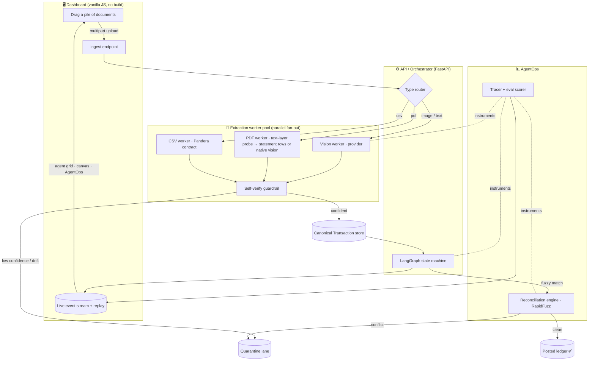
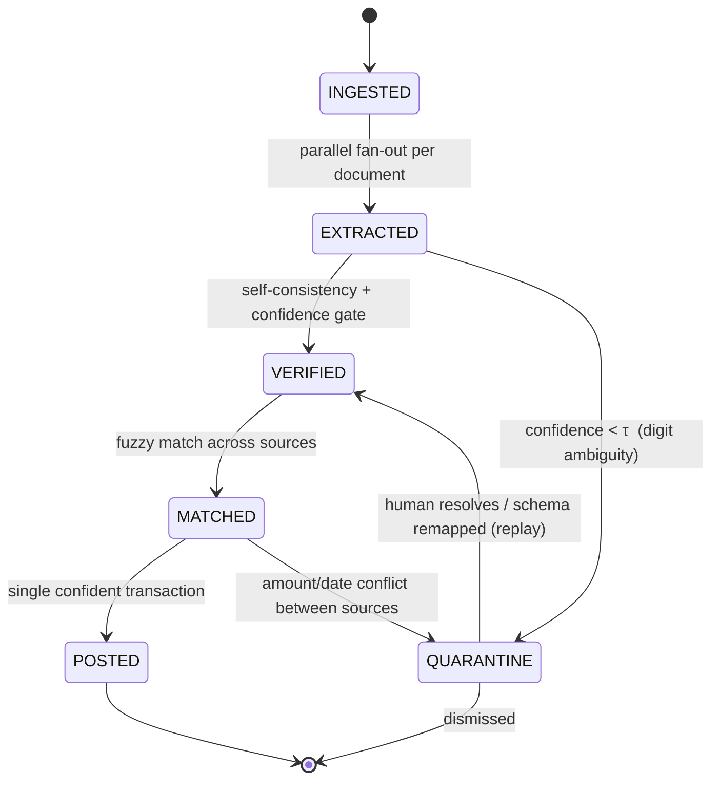
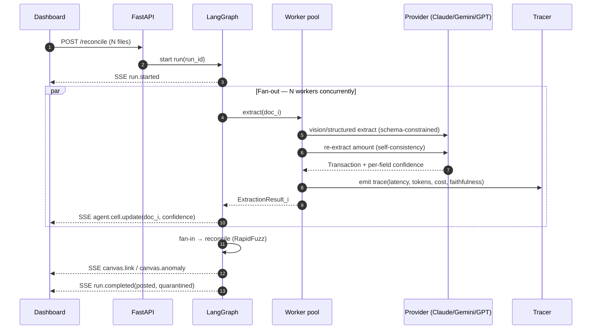
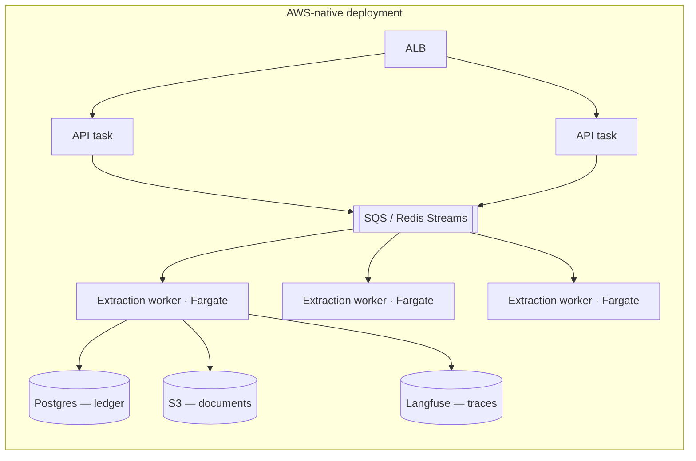
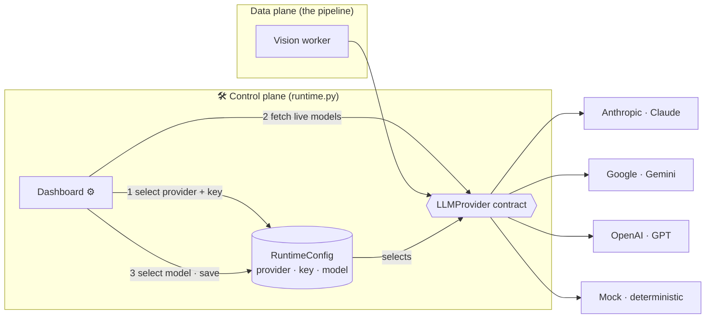
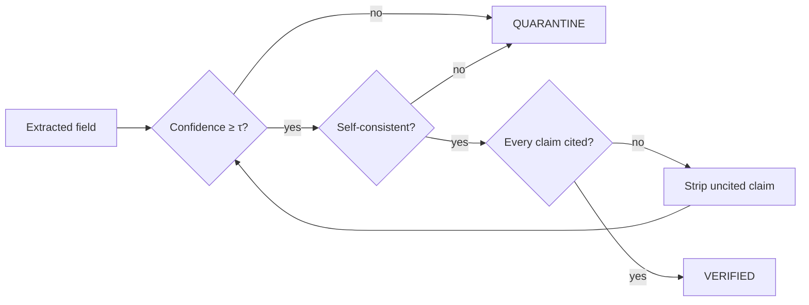

# FinProof — System Architecture

> **Thesis:** Reconciling financial documents is not an OCR problem, it is a
> *trust* problem. The hard part is not reading a receipt — it is producing a
> merged ledger you can stake money on. So this system is designed around a
> single invariant: **no number is POSTED unless it can be proven; anything
> unproven is QUARANTINED, never silently dropped or guessed.**
>
> The LLM is used where it is strong (messy perception, fuzzy judgement) and
> fenced off everywhere it is weak (arithmetic, final authority) by
> deterministic guardrails. *The LLM proposes; deterministic code disposes.*

**Companion docs:** [README](../README.md) (overview & quickstart) ·
[API.md](./API.md) (REST + SSE reference) · [DEPLOY.md](./DEPLOY.md) (ship it free) ·
[CONTRIBUTING.md](./CONTRIBUTING.md) (extend it) · [CONFIGURATION.md](./CONFIGURATION.md) (settings) ·
[TROUBLESHOOTING.md](./TROUBLESHOOTING.md) (fixes) · [SECURITY.md](./SECURITY.md)

## Contents

1. [Problem framing & requirements](#1-problem-framing--requirements)
2. [System overview](#2-system-overview)
3. [The reconciliation state machine](#3-the-reconciliation-state-machine)
4. [The extraction request lifecycle](#4-the-extraction-request-lifecycle-sequence)
5. [The contract: canonical data model](#5-the-contract-canonical-data-model)
6. [Scale considerations](#6-scale-considerations)
7. [Latency trade-offs](#7-latency-trade-offs-the-decisions-worth-defending)
   · [7.5 Pluggable providers & the control plane](#75-pluggable-model-providers--the-runtime-control-plane)
8. [Failure modes & hardening (AgentOps)](#8-failure-modes--hardening-agentops--guardrails)
9. [Security & data governance](#9-security--data-governance)
10. [Technology choices & rejected alternatives](#10-technology-choices--and-the-alternative-i-rejected)
11. [What I'd build next](#11-what-id-build-next-honest-roadmap)

> **TL;DR for reviewers:** §2–§4 are the system shape and the safety state
> machine; §6–§7.5 are the scale and the cost/provider trade-offs; **§8 is the
> one that separates a script from a system** — 8 named failure modes, each with a
> coded guardrail and a release-gated eval.

---

## 1. Problem framing & requirements

A person's spending is scattered across heterogeneous, contradictory sources:

| Source | Format | Failure characteristic |
|---|---|---|
| Bank / card statement | CSV | schema drifts silently (renamed columns, `MM/DD` ↔ `DD/MM`) |
| UPI app | screenshot (PNG) | partial info, no line items |
| Merchant receipt | photo / PDF | OCR digit errors (`450`→`480`), skew, glare |

The same purchase appears in 2–3 of these with **disagreeing amounts**, and naive
merging **double-counts**. The system must:

- **R1 — Extract** structured transactions from any of these formats.
- **R2 — Verify** each extraction and refuse to trust low-confidence reads.
- **R3 — Reconcile** across sources: link duplicates, surface conflicts.
- **R4 — Quarantine, not corrupt:** ambiguity routes to human review.
- **R5 — Be observable:** every decision is traced, scored, timed, costed (AgentOps).
- **R6 — Be operable:** containerized, horizontally scalable, degrades gracefully.

### 1.1 Target Audience: Who Is This For?

While basic expense trackers focus on individual receipts, FinProof's architecture targets high-stakes institutional finance where unreconciled breaks cause financial loss, audit failures, and regulatory fines:

| Sector | Target Personas | Operational Problem Solved |
|---|---|---|
| **Commercial & Retail Banking** | Settlement & Recon Desk, Nostro/Vostro Reconcilers, Clearing Ops | Resolves millions of daily breaks between Core Banking Systems (CBS), payment switches (UPI / SWIFT MT940), and merchant batch settlements. |
| **Commercial Lending & Risk** | Credit Underwriters, Risk Analysts, Forensic Auditors | Cross-reconciles applicant bank PDF statements against GSTR-2A/3B returns and vendor invoices to detect fabricated balances, inflation, and round-tripping. |
| **Enterprise CFO Suite** | Accounts Payable (AP) Lead, Financial Controller, SOX Auditors | Automates 3-Way & 4-Way Matching: Purchase Orders (PO) vs. Delivery Challans / Goods Received Notes (GRN) vs. Vendor Tax Invoices vs. Bank Clearing Feeds. |
| **FinTechs & Payment Gateways** | Merchant Settlement Ops, Dispute & Chargeback Specialists | Reconciles merchant POS terminal logs, mobile UPI transaction screenshots, and bank settlement notifications. |

### Non-goals
Full accounting/double-entry bookkeeping, multi-currency FX, and bank API
integrations are explicitly out of scope for v1 — they are additive and would
dilute the core demonstration of *trustworthy autonomous reconciliation*.

---

## 2. System overview



**Data flow in one sentence:** upload → type-routed **parallel** extraction →
self-verification gate → fan-in to canonical store → reconciliation → state
machine routes each transaction to POSTED or QUARANTINE → every hop emitted as a
trace event to the dashboard.

### 2.1 Deterministic vs. Non-Deterministic Agents

Financial ledgers demand absolute mathematical and statutory reproducibility. LLMs cannot be trusted with raw arithmetic or un-audited ledger commits, yet rigid deterministic parsers collapse when confronted with real-world document variations, distorted receipts, or schema drift.

FinProof solves this via strict separation of concerns:
> **"The LLM proposes; deterministic code disposes."**

| Characteristic | Deterministic Layer | Non-Deterministic (Agentic LLM) Layer |
|---|---|---|
| **Underlying Engine** | Algorithms, schemas, finite state machines | Multi-modal Foundation Models (Claude, Gemini, GPT) |
| **Output Property** | 100% reproducible, 0 variance, exact paise/cents | Probabilistic, semantic reasoning, vision perception |
| **Responsibilities** | • Pandera Schema Contracts (type, non-null, date ranges)<br/>• Canonical Pydantic `Decimal` data model<br/>• LangGraph State Machine conditional guards<br/>• RapidFuzz string distance & matching thresholds<br/>• Pre-egress regex PII redaction<br/>• Ledger invariance (rejection of unproven numbers) | • Multi-modal Vision Worker (reading distorted receipts & UPI)<br/>• Born-digital vs scanned PDF layout analysis<br/>• Semantic Merchant Normalizer (e.g. `AMZN BLR` → Amazon)<br/>• Dual-read self-consistency verification<br/>• AI Quarantine Advisor (synthesizing discrepancy remedies)<br/>• Conversational Ledger Chatbot & inline CSS chart rendering |
| **Failure Defense** | Catches schema anomalies, drops bad rows to Quarantine | Bounded by deterministic schemas; cannot self-approve to POSTED |

### 2.2 Multi-Agent Swarm Topology & Coordination

Rather than a monolithic prompt chain, FinProof deploys a swarm of 6 specialized agents:
1. **Ingestion & Security Router Agent:** Magic-bytes MIME sniffing, file validation, and PII masking.
2. **Parallel Extraction Worker Swarm:** Fan-out workers (Vision Worker, PDF Worker, Tabular CSV Worker) running concurrently.
3. **Self-Verification Agent:** Runs perturbation-based dual-reads, element-wise array verification, and confidence thresholding.
4. **Graph Reconciliation & Matching Agent:** Multi-way entity matching across merchant strings, date windows, and monetary exactness; collapses duplicates and isolates anomalies.
5. **AI Quarantine Advisor Agent:** Diagnoses root causes of isolated conflicts and constructs structured action payloads.
6. **Conversational Ledger & Analytics Agent:** Natural language query engine translating ledger queries into structured analytics and animated charts.

---

## 3. The reconciliation state machine

Orchestration is a **LangGraph** graph. We chose a graph over an ad-hoc `async`
script for three concrete reasons: (1) built-in **checkpointing** gives us replay
and an audit trail for free (R5/R6); (2) conditional edges make the quarantine
branches explicit and testable; (3) state is a typed object, not scattered
locals.



**Why a state machine and not a prompt chain?** Each transition is a *guard*, not
a suggestion. `VERIFIED` is only reachable if deterministic checks pass; the model
cannot "talk its way" into POSTED. This is the structural difference between a
demo and a system you would let touch real money.

### 3.1 Manual Intervention & Quarantine Lifecycle (Human-in-the-Loop)

In financial systems, automated execution must halt and quarantine whenever ambiguity threatens ledger integrity. The Human-in-the-Loop (HITL) pattern is structured across three axes:

#### 1. WHAT is missing or not matching?
* **Cross-Source Amount Conflict:** Mismatched values between independent documents (e.g. Receipt ₹450 vs Bank Statement ₹540).
* **Missing Supporting Document (Orphan Leg):** A bank debit without a corresponding invoice/PO, or an invoice without a clearing record.
* **Low Extraction Confidence:** Per-field confidence $\tau < 0.80$ resulting from faded thermal paper, skewed angles, or visual glare.
* **Schema Drift & Unmapped Columns:** Column header shifts in bank CSVs that cannot be mapped with $\ge 90\%$ confidence.
* **Tax & Arithmetic Invariance Failures:** Line-item sums disagreeing with invoice totals, or GST calculation discrepancies.

#### 2. WHERE is it surfaced?
* **Dedicated Quarantine Lane:** Visually and logically separated from the `POSTED` ledger to prevent downstream report pollution.
* **Visual Evidence Canvas (Side-by-Side Diff):**
  * Primary source image/text snippet with bounding box highlight over the disputed field.
  * Secondary source record (e.g. statement row or ERP PO).
  * Delta Badge displaying exact amount variance ($\Delta$), percentage skew, and merchant similarity score.
* **AgentOps Trace Panel:** Full audit view of the prompt, model output, and verification check that triggered quarantine.

#### 3. HOW is the manual intervention executed?
* **AI Quarantine Advisor (✨ AI Suggest):** Synthesizes the discrepancy context and provides 2–3 structured, risk-assessed actions (e.g. *"Use Statement ₹540"*, *"Use Receipt ₹450"*, *"Dismiss"*).
* **One-Click State Transition:** Clicking an option transitions the record directly from `QUARANTINE` to `POSTED` (or `DISMISSED`) via `/runs/{id}/quarantine/{txn_id}/resolve`.
* **Immutable Audit Ledger:** Every override logs reviewer ID, timestamp, selected remedy, and rationale into the append-only event stream.
* **Interactive Field Editing:** Reviewers can manually correct values; deterministic validators (Pydantic / Pandera) re-validate before moving to `POSTED`.
* **Adaptive Policy Synthesis:** Reviewers can mark recurring patterns to auto-generate deterministic rules for future runs.

---

## 4. The extraction request lifecycle (sequence)



The `par` block is the heart of the performance story: workers are stateless and
independent, so wall-clock latency is bounded by the **slowest single document**,
not the sum.

**Run durability (decoupled execution).** The run is launched by `POST /reconcile`
and runs to completion as a background task — *independent of whether any browser
is connected*. The SSE endpoint is a pure **tailer** over a per-run replay buffer
(see `events.EventBus`): on connect it replays the full event history, then streams
live. This eliminates a whole class of races — "the dashboard subscribed a moment
too late and the run looks hung / empty forever" — and means the result is durably
fetchable from `/runs/{id}` even if the client never opened the stream. In
production this same contract is provided by Redis Streams / an SQS consumer group
(replay + at-least-once) with no change to callers. See failure mode **F8**.

---

## 5. The contract: canonical data model

All sources are normalized to one Pydantic schema. This schema *is* the
integration contract — it is the only thing the reconciliation engine sees, which
is what lets us add a new source (e.g. a PDF invoice) without touching the engine.

```python
class FieldConfidence(BaseModel):
    value: float            # 0..1, model-reported + calibrated
    method: str             # "self_consistency" | "schema" | "ocr_agreement"

class Transaction(BaseModel):
    id: str
    source_doc: str
    source_type: Literal["receipt", "bank_csv", "upi_screenshot"]
    merchant: str
    amount: Decimal         # Decimal, never float — money is exact
    currency: str = "INR"
    txn_date: date
    confidence: dict[str, FieldConfidence]
    state: Literal["EXTRACTED","VERIFIED","MATCHED","POSTED","QUARANTINE"]
    evidence: list[str]     # crop refs / source rows backing every claim
```

Two deliberate choices: **`Decimal` not `float`** (financial correctness), and an
**`evidence` trail on every record** (so a QUARANTINE flag can always show *why*).

---

## 6. Scale considerations

The local stack (`docker compose up`) and the production topology are the *same
shape* — stateless API + worker pool — so scaling is a matter of swapping
in-process primitives for managed ones, not redesigning.



| Dimension | Local (v1) | Production path |
|---|---|---|
| **Fan-out** | `asyncio` + bounded semaphore | SQS/Redis Streams + Fargate worker pool, autoscaled on queue depth |
| **State / checkpoint** | LangGraph in-memory saver | LangGraph Postgres checkpointer (durable replay across restarts) |
| **Ledger store** | SQLite | Postgres (RDS), partitioned by user |
| **Documents** | local disk | S3 + presigned uploads (keep large blobs off the API path) |
| **Throughput knob** | `LEDGER_MAX_CONCURRENCY` | worker replica count |

**Back-of-envelope:** at ~3s/document extraction and 8 concurrent workers, one
worker task clears ~160 docs/min. Because extraction is embarrassingly parallel
and stateless, throughput scales linearly with worker replicas until the upstream
model rate limit — at which point the bottleneck is *quota*, addressed below
under cost/model-routing, not architecture.

---

## 7. Latency trade-offs (the decisions worth defending)

1. **Parallel fan-out vs. sequential.** Sequential is simpler but latency is
   `Σ(docs)`. Fan-out makes it `max(docs)` at the cost of concurrency control and
   harder tracing. We pay that cost — a 17-document pile goes from ~50s to ~4s.
   The bounded semaphore (`LEDGER_MAX_CONCURRENCY`) prevents us from melting the
   model rate limit while fanning out.

2. **Self-consistency double-extraction vs. single pass.** Extracting each amount
   twice ~doubles per-field token cost on *amounts only*. We accept it because the
   #1 failure (silent digit misread) is invisible without it — a wrong number that
   *looks* confident is worse than a slow one. This is a latency-for-trust trade.

3. **Two-tier model routing (latency × cost × accuracy).** Clean documents go to
   a fast model; only low-confidence/ambiguous ones escalate to the deep model.
   ~80% of docs never need the expensive path, so p50 latency and cost track the
   *fast* model while accuracy on the hard 20% tracks the *deep* one. Both models
   are chosen per-provider from the dashboard (see §7.5).

4. **SSE vs. WebSocket for live updates.** The dashboard only needs
   *server→client* streaming. SSE is one-directional, survives proxies, and
   auto-reconnects — strictly simpler than WebSocket for this access pattern, with
   no feature we'd miss.

---

## 7.5 Pluggable model providers & the runtime control plane

The two-tier routing above assumes a model — but *which vendor's* model should
not be welded into the pipeline. A reconciliation engine is a long-lived asset; the
model market underneath it changes monthly. So provider choice is a **runtime
configuration**, not a compile-time dependency.



**The contract.** Every vendor implements one primitive — `complete(prompt) →
text + token usage`. The high-value logic that must be *identical* across vendors —
the two-read **self-consistency** guardrail (F1) and **retry/backoff** (F6) — lives
once in the base class. Adding a vendor is one method, not a new pipeline. The
extraction worker imports `LLMProvider`; it never imports an SDK, so a vendor's
client library is a lazily-loaded, *optional* dependency.

**Mock is a first-class provider, not a special case.** The deterministic parser
*is* the mock provider, and also the universal degradation target: if any live
provider call fails, the worker falls back to that same parse (F6). This is why
the demo and the eval gates are deterministic regardless of which vendor is
selected.

**The dashboard is the only decision-maker.** There is deliberately no env-based
provider/key/model selection. The system **always boots to mock** and stays there
until an operator configures it through the UI — so an ambient `OPENAI_API_KEY` in
the shell can never silently change what the agent does, and the default is always
the safe, deterministic one. `config.Settings` carries *ops* config only (thresholds,
concurrency, retries, the admin token); `runtime.RuntimeConfig` is the live model
picture the dashboard mutates (`PUT /config`) with no restart.

**Models are discovered, not typed.** Free-text model IDs are error-prone, so once a
key is supplied the dashboard calls `POST /providers/{id}/models`, which asks the
*vendor* what that key can actually use (`client.models.list()` for Anthropic/OpenAI,
`aio.models.list()` for Gemini) and populates a dropdown. The static catalog is only
a pre-key fallback and the source of cost pricing.

Two more non-negotiables:

- **Secrets are write-only.** `public_snapshot()` reports *whether* a key is
  configured, never the key. A key submitted from the dashboard can never be read
  back out — only replaced.
- **Safe by default.** Selecting a provider with no key doesn't error; it
  *collapses to mock* (`effective_provider`), so a misconfiguration degrades to the
  deterministic demo instead of a 500. An optional `LEDGER_ADMIN_TOKEN` gates the
  key-bearing config + model-fetch endpoints — a stand-in for the RBAC a production
  control plane would enforce.

**Scale note.** Today the control plane is process-local (ideal for one API task or
the demo). For multiple replicas, back `RuntimeConfig` with a shared store (Redis /
SSM Parameter Store) so every replica sees the same provider config — the call
sites (`get_runtime()`) do not change. Cost attribution stays correct across vendors
because pricing is one auditable catalog table keyed by model id.

---

## 8. Failure modes & hardening (AgentOps + guardrails)

This is the section that separates a script from a system. For each natural
failure we name the guardrail and where it lives in code.

| # | What naturally breaks | Guardrail / state-machine response | Lives in |
|---|---|---|---|
| F1 | **Vision misreads a digit** (`₹450`→`₹480`) | Amount extracted twice; if the two reads disagree → `QUARANTINE`, never posted | `extraction/verify.py` |
| F2 | **Same purchase double-counted** across sources | Reconciliation fuzzy-matches `amount×date×merchant`; duplicates collapse to one linked entry | `graph/matching.py` |
| F3 | **Cross-source amount conflict** (receipt ₹450 vs statement ₹540) | Match found but amounts disagree → `ANOMALY` → `QUARANTINE` with both values + evidence | `graph/reconciliation.py` |
| F4 | **Hallucinated field** (invented merchant/date) | Output is schema-constrained; every claim must cite `evidence`; uncited claims stripped pre-`VERIFIED` | `schemas.py` + `verify.py` |
| F5 | **Bank CSV schema drift** (renamed/reordered column) | Pandera contract validates headers/types; on drift, rows go to `QUARANTINE` and a remap is proposed, then **replayed** — no crash, no corruption | `extraction/csv_ingest.py` |
| F6 | **Model API failure / rate limit** (any provider) | Retry w/ exponential backoff + jitter (`LEDGER_MAX_RETRIES`); transient 429/5xx/timeout are retried, then the doc **degrades to the deterministic parser** — if that read is itself low-confidence, the verify gate quarantines it. The run always completes. The retry logic lives once in the provider base class, so it is identical for Anthropic/Google/OpenAI | `providers/base.py` |
| F7 | **No / wrong API key, or unknown provider** | Selecting a provider with no key **collapses to deterministic mock mode** (`effective_provider`) rather than erroring; the system — and the live demo — never hard-fails. A bad key can be caught up-front with `POST /config/test` | `runtime.py` |
| F8 | **Dashboard connects late, SSE drops, or is blocked by a proxy** | Run execution is **decoupled from streaming**: it launches on `POST /reconcile` and completes regardless of who's watching. The event bus keeps a **per-run replay buffer**, so a late/reconnecting subscriber receives full history then tails live; if SSE can't connect at all, the client **falls back to polling** `/runs/{id}`. A failed run emits `run.failed` rather than hanging | `events.py` + `main.py` + `frontend/app.js` |
| F9 | **Pixels with no reader** (scanned PDF / photo in mock mode, or the vision call fails) | There is **no deterministic pixel parser**, so the document is `QUARANTINE`d with an explicit reason ("needs a vision-capable provider") — a number is **never fabricated**. A failed live vision call surfaces as `<provider>→quarantine` in the trace, not as a silent mock run | `extraction/vision.py` + `extraction/pdf_ingest.py` |
| F10 | **Non-financial document uploaded** (e.g. a random app screenshot) | The visual extraction also *classifies*: `kind="other"` zeroes confidence → `QUARANTINE` ("classified as non-financial"), with the model's reading kept as evidence | `providers/base.py` + `extraction/vision.py` |
| F11 | **Statement row drift** (the model miscounts or misreads rows in a many-page statement) | Two full reads: rows, then an independent amount-only column re-read. Deterministic code compares them **element-wise** — a disagreeing row collapses to 0.55 and quarantines *individually*; a count mismatch collapses every row. The model never grades itself | `providers/base.py · extract_statement` |
| F12 | **PII leaves the process** (account numbers, PAN, IFSC, phones, emails in outbound prompts) | Deterministic regex redaction (`privacy.py`) masks identifiers (keeping the last 4 chars) before any document **text** reaches a live provider; amounts survive by construction. Mock mode never sends bytes anywhere. Pixels can't be masked — disclosed in SECURITY.md | `privacy.py` + workers |
| F13 | **Hostile/oversized uploads** (lying extensions, unknown binaries, huge files) | Routing trusts **magic bytes, never filenames**; unknown binaries quarantine with a reason; per-file size and per-run count caps return structured 4xx | `extraction/sniff.py` + `main.py` |

### The validation state machine, precisely



> **Design principle restated:** the model can only ever *propose* a transition.
> Deterministic guards (`τ`, self-consistency, citation, Pandera) decide whether
> it actually happens. That asymmetry is what makes the autonomy safe.

### AgentOps: what we measure

Every node emits a trace span carrying: `latency_ms`, `input/output_tokens`,
`usd_cost`, `model`, and an eval score. The per-span eval is **faithfulness** —
does the extracted value have backing evidence? — computed deterministically from
the `evidence` field, not by asking another LLM (grading an LLM with an LLM just
stacks uncertainty). These stream to the dashboard's AgentOps tab and (if
configured) persist to Langfuse for historical dashboards and regression datasets.

### Evals & release gates (the discipline, not just the dashboard)

> *You cannot improve what you do not measure — and for a system that touches
> money, the metric that matters is not accuracy, it's **quarantine recall**: did
> we catch everything we were supposed to refuse to post?*

Tracing tells you what *one run* did. **Evals** tell you whether the system is
still correct after a change. `backend/evals/` runs the real extraction +
reconciliation paths over a hand-labeled **golden set** (`evals/dataset.py`) and
scores three layers of truth, then **gates** on them:

| Metric | What it proves | Gate |
|---|---|---|
| `amount_exact_rate` | every amount was read exactly (no silent digit drift) | ≥ 1.0 |
| `quarantine_recall` | **safety** — nothing un-postable slipped through | ≥ 1.0 |
| `quarantine_precision` | humans aren't drowned in false quarantines | ≥ 1.0 |
| `link_f1` | exactly the right duplicates/anomalies were found | ≥ 1.0 |
| `confidence_gate_separation` | posted items are *strictly* more confident than low-confidence quarantines (calibration sanity) | > 0 |

The scorecard also reports **guardrail attribution** — which guard caught each
quarantine. On the golden set, the BREW & CO conflict is caught by the
*reconciliation* guard (2 rows) while CAFE ZEST is caught by the *confidence* guard
(1 row), proving the two guardrails are independent and both load-bearing. In mock
mode the whole eval is deterministic, so these thresholds are an executable
contract: `pytest tests/test_evals.py` turns a silent quality regression into a red
build. Run it live with `python -m evals.run`.

---

## 9. Security & data governance

- **PII at rest:** financial documents are sensitive. Locally they stay on disk;
  in prod they live in S3 with SSE-KMS and short-lived presigned URLs — the API
  never holds the blob.
- **No silent egress:** the only external call is to the model provider, and only
  document *content* needed for extraction is sent; nothing is logged in cleartext
  to traces (trace payloads carry derived fields + crop refs, not raw images).
- **Secrets are write-only:** provider API keys are supplied from the dashboard,
  held only in the runtime control plane, and never serialized back out —
  `public_snapshot()` reports *whether* a key is set, never its value (§7.5).
- **Human-in-the-loop gate:** the `QUARANTINE → VERIFIED` transition requires an
  explicit human resolution — the system never auto-approves its own uncertainty.

---

## 10. Technology choices — and the alternative I rejected

| Decision | Chosen | Rejected alternative | Why |
|---|---|---|---|
| Orchestration | LangGraph | hand-rolled `async` chain | checkpointing, replay, explicit guarded edges, audit trail |
| Extraction | LLM vision, schema-constrained | standalone OCR (Tesseract/Paddle) | OCR returns text, not *structured + confidence-scored* fields; reconciliation needs the latter |
| CSV integrity | Pandera contract | trust-the-headers parsing | drift is the #1 real-world breakage; a contract turns a 3am crash into a quarantine |
| Matching | RapidFuzz (deterministic) | LLM "are these the same?" | matching must be fast, cheap, explainable, and unit-testable — not a token spend |
| Money type | `Decimal` | `float` | float arithmetic on currency is a correctness bug, not a style choice |
| Live updates | SSE | WebSocket | one-directional stream; simpler, proxy-friendly, auto-reconnect |
| Observability | Langfuse (optional) + in-proc tracer | print logging | evals + traces are the differentiating "AgentOps" signal; in-proc fallback keeps it dependency-light |
| Model provider | uniform `LLMProvider` adapter + runtime control plane | one hard-wired vendor | swap Anthropic/Google/OpenAI/mock from the dashboard with no redeploy; the pipeline never imports an SDK, and per-vendor client libs stay optional |

---

## 11. What I'd build next (honest roadmap)

- **Confidence calibration:** the eval scorecard already checks confidence
  *separation* (posted vs low-confidence quarantines); the next step is full
  calibration against a larger labeled set (reliability curve / ECE) so `τ` is
  principled, not chosen. The harness in `backend/evals/` is where that lands.
- **Active-learning loop:** every human QUARANTINE resolution becomes a new golden
  row → expands the eval set → a regression gate → measurable extraction
  improvement over time. The gated scorecard is the foundation this builds on.
- **Durable checkpointer + queue:** swap in Postgres checkpointer and SQS to make
  runs resumable across restarts (the production path in §6).
- **Receipt line-item reconciliation:** match at the line-item level, not just the
  transaction total.
